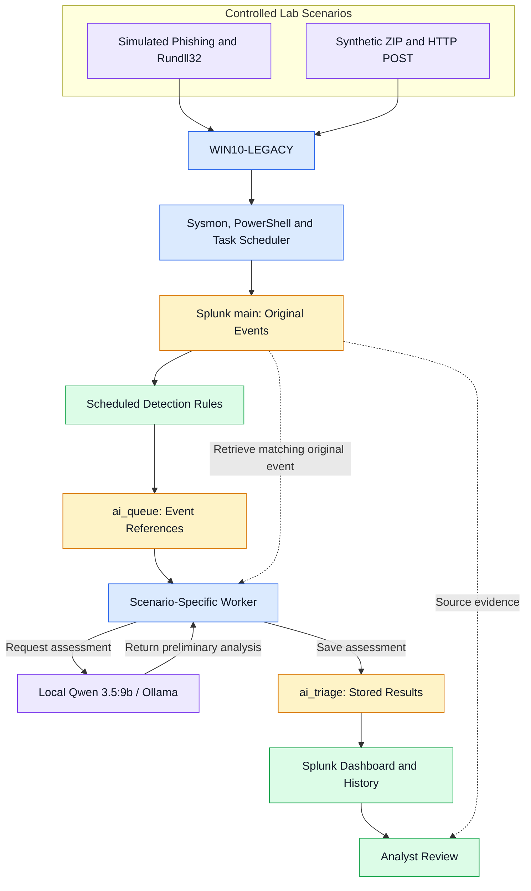

# Purple Lab — Splunk Detection & Local Qwen Triage

### Controlled Simulations · Detection Engineering · Local AI Analysis

## Project Overview

This project documents two controlled Windows scenarios in my Purple Lab, connecting Windows telemetry with Splunk detections, locally hosted Qwen analysis and analyst review.

The work covers a simulated phishing delivery followed by scheduled-task and Rundll32 execution, and a separate PowerShell HTTP POST test using synthetic documents.

The objective was to validate the workflow from recorded activity to a saved AI assessment, while keeping the original evidence available for investigation.

Full reports are available in English and Serbian.

## Lab Workflow

The worker retrieves the original event, requests a local model assessment and stores the response. Dashboard refreshes read saved results without triggering another model request.

## Environment

| Component | Role |
|---|---|
| WIN10-LEGACY | Windows endpoint used for both controlled scenarios |
| Kali Linux | Laboratory email delivery, HTTP services and internal receiver |
| Mailpit | Simulated phishing message delivery |
| Sysmon | Process creation and network connection evidence |
| PowerShell logging | Script block evidence through Event ID 4104 |
| Task Scheduler logs | Task registration and execution evidence |
| Splunk Enterprise | Event collection, investigation, scheduled detections and dashboard |
| Ollama and qwen3.5:9b | Locally hosted preliminary event analysis |

## Documented Scenarios

| Scenario | Validation focus | Verified outcome |
|---|---|---|
| Rundll32 execution | Simulated phishing delivery, explicit user execution, scheduled task and proxy execution | Benign Notepad execution, correlated Windows records, a dedicated Splunk detection and saved Qwen assessments |
| PowerShell HTTP POST | Synthetic document archiving and an internal HTTP upload command | Correlated PowerShell and Sysmon evidence, scheduled detection and automatic local Qwen processing |

## Scenario 1 — Rundll32 Execution

A laboratory Mailpit message contained a download link to a test CMD file.

The user explicitly downloaded and opened the file. CMD launched PowerShell, which registered a scheduled task. Task Scheduler subsequently launched Rundll32, which opened benign Notepad.

The investigation correlated:

- Edge, CMD and PowerShell process records.
- Scheduled-task registration and execution events.
- Rundll32 execution using pcwutl.dll,LaunchApplication.
- The Notepad child process and successful task-action result.

The dedicated rule `purplelab_rundll32_launchapplication` detected the Rundll32 pattern. Later replays produced saved local Qwen assessments.

Primary detection mapping: **T1218.011 — Rundll32**.

## Scenario 2 — PowerShell HTTP POST

A separate test prepared synthetic documents, created a ZIP archive and issued a PowerShell HTTP POST command to an internal Kali receiver.

The investigation correlated PowerShell script blocks with the originating process and its network connections.

The dedicated rule `purplelab_powershell_http_post_file` identified the upload command. A fresh replay validated the scheduled path from detection to saved AI triage.

PowerShell execution mapping: **T1059.001**.

The recorded command and TCP connection support the observed activity. Confirmation of file receipt requires separate receiver-side evidence.

## Local Qwen Triage

The integration uses three Splunk indexes:

| Index | Purpose |
|---|---|
| main | Original Windows events |
| ai_queue | Event references awaiting processing |
| ai_triage | Saved model assessments and review status |

Each scenario has a corresponding processing worker. The worker retrieves the original event and requests an assessment through the local `Qwen35_9B_Local_AI` connection.

The prompt asks the model to explain:

- Confirmed facts in the supplied event.
- Relevant command parameters.
- Host and process context.
- Supported ATT&CK mappings.
- Missing evidence and further investigation needs.

Early responses contained identity and ATT&CK mapping errors. The prompt was refined to improve the distinction between recorded facts, interpretation and unsupported conclusions.

The analyst reviews the assessment against the source evidence and makes the final decision.

## Validation Results

| Measure | Documented result |
|---|---|
| Controlled scenarios | 2 |
| Dedicated detection and AI processing paths | 2 |
| Saved Qwen assessments | 3 |
| Assessments awaiting analyst review | 3 |
| Saved empty responses in the dashboard snapshot | 0 |

The three assessments represent two Rundll32 replays and one HTTP POST replay.

For one HTTP POST replay, approximately **2 minutes and 56 seconds** elapsed between the Windows event and the saved assessment. This includes scheduled processing and does not represent model inference time alone.

The `completed` status confirms that a non-empty response was saved. The `pending` review status indicates that analyst validation is still required.

## Evidence and Validation

The reports contain original screenshots, Windows event references, process relationships, detection results and saved Qwen assessments.

The documented results distinguish the full scenario context from the evidence available to an individual model request.

All activities were performed in a personal laboratory using test artifacts and an internal receiver. The implemented workflow ends with analyst review.

## Full Reports

- [Read the English report](./reports/Purple_Lab_Splunk_Local_AI_Validation_Report_EN.pdf)
- [Pročitaj izveštaj na srpskom](./reports/Purple_Lab_Splunk_Local_AI_Validation_Report_SRB.pdf)

## Author

**Mladen Starčević**

Cyber Defense · Detection Engineering · Incident Response
